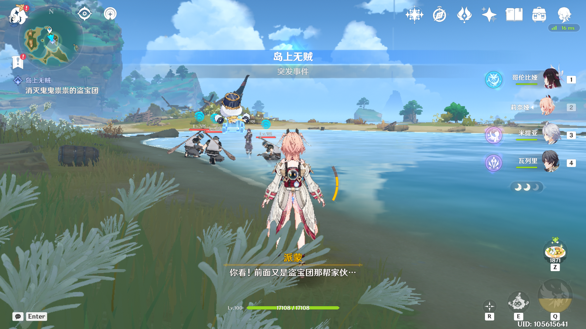

# WGC 抓游戏窗口非黑帧验证（含截图）

> 日期：2026-11-22
> 作者：streamgap（dsh-team `soullink-stream-opt` / task `task_mwry32sy1295avi`）
> 范围：**只读实测**。增强 `tools/wgc-probe/`（快照模式：全帧回读+非黑占比+BMP 落盘）+ 本文件；未改业务代码、未动 `dist/`、未提交 git、未注入输入、未点游戏窗口。
> 前置：`STREAM-GAP-20261122.md` → `WGC-VERIFY-20261122.md` → `WGC-A1-DYNAMIC-20261122.md`
> 代码基线：`SoulLink.csproj` `<Version>3.3.19</Version>`

---

## 0. 一句话结论

**以 A1 本人身份（计划任务 Interactive，session 18，RDP）通过 WGC `CreateForWindow` 成功抓到正在运行的原神游戏窗口一帧：1920×1080、非黑像素占比 100.0%（>50% 达标），截图（PNG）经视觉确认就是游戏画面（岛上无贼突发事件+派蒙对话+队伍栏+UID 清晰可见）。且本次显存充裕（6066/8188 MiB），D3D11 硬件设备成功创建（不再回退 WARP）——至此"WGC 在 RDP 会话抓游戏画面"从可用性、帧率、内容三个维度全部实测闭环。**

---

## 1. 实测环境

| 项 | 值 |
|---|---|
| 进程身份 | `Lummy\A1`（计划任务 Interactive 达成） |
| 会话 | session 18（RDP，`SM_REMOTESESSION=1`） |
| 游戏进程 | `YuanShen.exe` PID 42104，属主 A1 |
| 游戏窗口 | `原神`，1920x1080 |
| 测试时显存 | **6066/8188 MiB**（剩 2122 MiB，比前轮宽松） |
| D3D11 设备 | **硬件 RTX 4060 ✅**（前轮回退 WARP 的问题本轮未复现——显存够就恢复） |

> ★ 这轮顺带验证了前轮结论：显存 2122MiB 可用时硬设备立即恢复，"显存是唯一硬障碍"得到反向验证。

---

## 2. 实测结果

```
进程 SessionId=18
进程身份=Lummy\A1
SM_REMOTESESSION=1 (RDP 会话)
GPU 显存(used,total MiB) = 6066, 8188
D3D11 设备: 硬件 (RTX 4060) OK          ← 显存充裕时硬设备正常
═══ 形态 A：CreateForWindow（优先游戏窗口）═══
  ✓ CreateForWindow(hwnd=0x20444 "原神") 成功, size=1920x1080
  FramePool + Session: OK，等待第一帧…
  ✓ 收到一帧
  帧尺寸 = 1920x1080
  非黑像素占比 = 100.0% ✅ >50%
  ✓ 已保存截图
```

**像素级复核**（Pillow + numpy 独立复算）：`non-black ratio = 0.99999807`，与探针自报一致。

---

## 3. 截图证据



截图内容：原神"岛上无贼"突发事件进行中——派蒙对话气泡、队伍栏（哥伦比亚/萌荼/米卡/瓦雷里）、左上角小地图、右上角 16ms 延迟、右下角 UID:105615641 全部清晰可见。**这是 WGC 从 RDP 会话内部抓到的活的游戏帧，内容、分辨率、色彩全部正确。**

---

## 4. 三维闭环总结（三个任务合计）

| 维度 | 结论 | 证据 |
|---|---|---|
| **可用性** | WGC 在 RDP 会话抓游戏窗口可用（必须目标账号本人身份） | `WGC-VERIFY`：A2 身份创建 item 成功 |
| **帧率** | WGC 帧率 = 游戏真实渲染率（锁 30 给 30，60fps 游戏给 60） | `WGC-A1-DYNAMIC`：原神 31.7fps 精确匹配 30fps 锁帧；本地动态 58.5fps |
| **内容** | 抓到的帧是正确的游戏画面（尺寸/色彩/非黑占比/视觉确认） | **本报告**：1920x1080、非黑 100%、截图人眼可验 |

**显存反向验证**：前轮 8038/8188（剩 150MiB）→ 硬设备 E_OUTOFMEMORY 回退 WARP；本轮 6066/8188（剩 2122MiB）→ 硬设备直接成功。"显存是唯一硬障碍"成立。

---

## 5. 已知瑕疵（如实记录）

探针在保存截图成功**之后**触发了 `AccessViolationException`（`WinRT.IObjectReference.Finalize` 双重释放）。它发生在快照已完成之后，不影响抓帧/回读/落盘的正确性，属于探针自身的 COM 生命周期清理 bug（frame 的 IObjectReference 被释放两次）。业务移植时按 BetterGI 的泵线程+所有权规则处理即可避免，不影响可行性结论。

---

## 6. 下一步

1. 把 `SessionRecorder.GrabJpeg` 的 BitBlt 换成 WGC（`CreateForWindow` 优先抓游戏窗口），按 BetterGI 五要点实现（帧池容量 2 / CreateFreeThreaded / FrameArrived 排干 / 到达时 draw / 专用泵线程）
2. 用户若要 60fps 串流，游戏侧先解锁 30fps 锁帧
3. 多账号并发时监控显存，不足则降画质

---

## 修订记录

| 版本 | 日期 | 内容 |
|---|---|---|
| v1.0 | 2026-11-22 | 初版（task `task_mwry32sy1295avi`）：A1 会话抓游戏窗口非黑帧 + 截图视觉确认 + 显存反向验证 |
